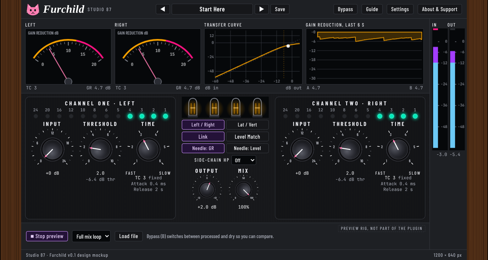

# Furchild

A free, open source, cat-themed take on a classic stereo variable-mu tube limiting amplifier (VST3 for Linux, Windows and macOS).

The real plugin window, rendered by the plugin itself.

## Status
Pre-release test build (v0.1.0). The plugin is built from the approved mockup. CI builds it on Linux, Windows and macOS and runs the DSP tests and pluginval (strictness 5) on Linux. Not yet checked: real Windows and macOS hosts, a real Flatpak DAW, and listening tests against the hardware it is inspired by. See [ROADMAP.md](ROADMAP.md).

## Download
Get the single zip from the [Releases page](https://github.com/SpeakingColors/Furchild/releases). It holds a Windows installer (with uninstaller), a macOS installer (with an Uninstall app), a Linux Flatpak extension and plain .vst3 tarball, the PDF manual, INSTALL.txt, LICENSE and SHA256SUMS. Everything works offline.

## Why the installers show a warning
The installers are unsigned: code signing certificates cost money every year and this project is free. Windows may show a blue "unknown publisher" screen (More info, Run anyway). macOS may ask you to allow the package in System Settings, Privacy and Security. Check your download against SHA256SUMS if you like.

## Controls
Two channels with Input, Threshold and Time (six time constants, two automatic), Left / Right or Lat / Vert mode, Link, Level Match, side-chain high-pass, Output, Mix, Bypass, 16 factory presets plus your own, three looks, a resizable window and hover info bubbles on every control. Details are in the manual inside the zip.

## The design mockup
The original interactive mockup is kept in `docs/mockup/Furchild.html` (WebAudio preview; it works offline).

## Privacy
Collects nothing. No network access, no telemetry, no accounts.

## Support

  

Free and open source, made by one person. If it helps your music, a coffee on [Ko-fi](https://ko-fi.com/studio87) keeps it coming.

## License
AGPL-3.0-or-later, see [LICENSE](LICENSE).
